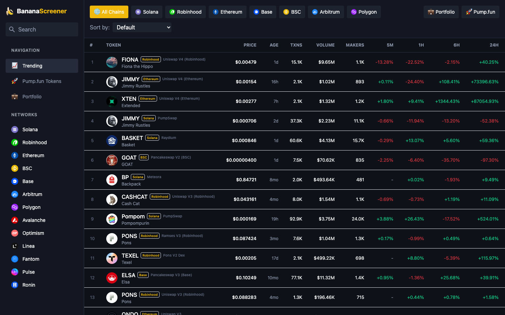

# 🍌 BananaScreener

**A multi-chain crypto token screener.** BananaScreener lists trending decentralized-exchange (DEX) trading pools across 13 blockchains. Each token page has a live price chart, recent trades, the most active wallets and a holder breakdown. It uses GeckoTerminal market data, with a Supabase cache in front.

**Live app:** [www.bananascreener.io](https://www.bananascreener.io)



---

## The problem

New tokens launch on many blockchains every day. Traders want one place to see what's trending, check a token's chart and trading activity, and look at who holds it before buying. Market-data APIs that serve this kind of data have strict rate limits, so a screener that calls them on every page view quickly gets throttled. BananaScreener's main design goal is to serve every visitor from its own cache while keeping data fresh in the background.

## Features

- **Trending table.** Trending pools across all chains or one chain at a time. It shows:
  - price, pool age, transaction count, volume, unique traders ("makers")
  - price change over 5 minutes, 1 hour, 6 hours and 24 hours

  Columns can be sorted, and rows load continuously as you scroll.
- **13 chains:** Solana, Robinhood Chain, Ethereum, BNB Chain, Base, Arbitrum, Polygon, Avalanche, Optimism, Linea, Fantom, PulseChain and Ronin.
- **Search.** Find tokens and pools by name, symbol or address.
- **Token page.** Includes:
  - **Pool chart:** a candlestick or line chart of that exact pool's price in USD, with volume, at 1m to 1D timeframes. It updates every 30 seconds.
  - **Optional TradingView chart:** shown only when the token's exchange listing passes a name-match check, so a different coin with the same ticker is never charted by mistake. If the chart fails to load, the page falls back to the pool chart.
  - **Token stats:** price, liquidity, market cap and FDV, buy/sell counts and volumes per timeframe, the GeckoTerminal trust score, socials and contract links.
  - **Transactions:** recent trades, refreshed every 10 seconds.
  - **Top Traders:** the most active wallets in the recent trades, by volume.
  - **Holders:** the top 150 holders with labels and wallet clusters. This comes from my companion project [BananaMaps](https://www.bananamaps.io), and the full BananaMaps bubble map can be opened right from the token page.
- **Mobile layout.** A dedicated phone layout with a bottom tab bar for Info, Chart and Transactions.

## How it works

```
 Visitor ──▶ Next.js API route ──▶ Supabase cache ──(fresh)──▶ response
                                        │
                                        └─(stale/missing)─▶ background refresh after the response
                                                              │
                                     GeckoTerminal API ◀── shared client: request coalescing,
                                                           in-memory cache, per-endpoint backoff
 Vercel Cron (daily) ──▶ pre-warms trending pages for every chain
```

- **Cache first.** Visitors always get data from Supabase. When a cached item is past its freshness window (2 minutes for trending, 1 minute for prices, charts and trades, 24 hours for token info), the response is sent right away and a refresh runs in the background (stale-while-revalidate).
- **One refresh at a time.** Before refreshing a row, an instance "claims" it with a conditional database update. Across all serverless instances, only one refresh per item happens in each window.
- **A careful API client.** All GeckoTerminal calls go through one client (`lib/gtClient.js`) that:
  - combines identical requests that are in flight at the same time
  - keeps a short in-memory cache
  - backs off exponentially on rate limits, following `Retry-After`
  - serves the last good data if a call fails
- **Graceful read-only mode.** If the database write key isn't configured, the site keeps serving cached data and logs one warning instead of failing.

## Tech stack

| Area | Technology |
|---|---|
| Web app | Next.js 14 (App Router), React 18, JavaScript |
| Styling | Tailwind CSS |
| Charts | TradingView Lightweight Charts v5 (pool chart), TradingView embed (optional) |
| Database / cache | Supabase (Postgres) |
| Market data | GeckoTerminal API; holder data from the BananaMaps API |
| Hosting | Vercel (with Vercel Cron and `waitUntil` background work) |

## Technical challenges and solutions

These are drawn from the commit history and code.

- **API rate limits under bursty traffic.**
  - *Problem:* calling GeckoTerminal on every page view triggered HTTP 429 errors.
  - *Solution:*
    - a shared client with request coalescing, caching and backoff
    - a database-first, stale-while-revalidate cache, so visitors never wait on the upstream API
- **A refresh lock that never "won."**
  - *Problem:* the background-refresh claim always looked like it failed. PostgREST applies the update's filter again to the returned rows, so `.select()` came back empty even when the update succeeded.
  - *How it was found:* a series of temporary diagnostic endpoints isolated the cause; they were removed afterwards.
  - *Solution:* check the affected-row `count` instead (`lib/screenerStore.js`).
- **Framework caching freezing database reads.** Next.js's data cache was serving old Supabase responses.
  - *Solution:* a custom `fetch` with `cache: "no-store"` for the database client (`lib/supabaseAdmin.js`).
- **Wrong charts from ticker collisions.** TradingView sometimes matched a different coin that shares a ticker.
  - *Solution:* the pool's own chart became the default, and TradingView is offered only after an exact name-match check (`lib/tvSymbolMatch.js`).
- **Chart data quality.** The upstream API sometimes returned duplicate or out-of-order candles, and prices were quoted in the paired token instead of USD.
  - *Solution:* candles are de-duplicated and sorted, charts are always in USD, and the price axis uses as many decimal places as the price needs.
- **Placeholder trust scores.** Some tokens report a default score of 100 with no breakdown behind it. These now show as N/A instead of a misleadingly perfect score.

## How I built this

I built BananaScreener using **AI-assisted development with Claude Code**. My role was:

- leading the product concept and defining the requirements
- testing against live market data on desktop and mobile
- debugging production issues such as the refresh-lock bug above
- deploying it on Vercel and Supabase

Claude Code generated most of the code under my direction. The project grew over 26 commits between April and October 2026.

## Running locally

```bash
npm install
# create .env.local with SUPABASE_URL, SUPABASE_ANON_KEY (+ NEXT_PUBLIC_ variants),
# SUPABASE_SERVICE_ROLE_KEY and CRON_SECRET
npm run dev   # http://localhost:3000
```

Create the cache tables by running [`supabase/migrations/20260713010000_screener_tables.sql`](supabase/migrations/20260713010000_screener_tables.sql).

## Disclaimer

Market data comes from GeckoTerminal. Nothing on this site is financial advice.
